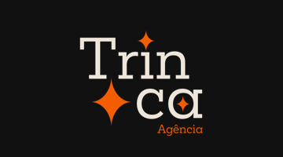
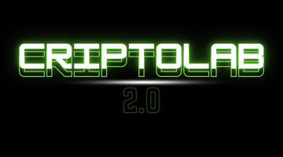
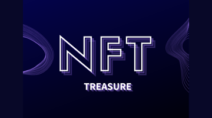
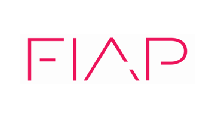
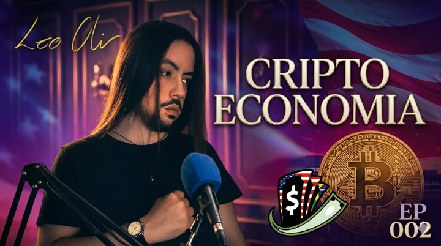
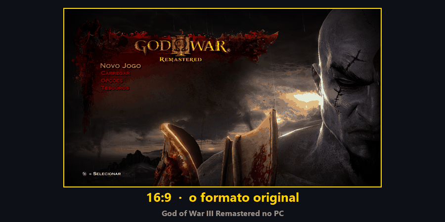

  

# Leo Oli (Leonardo de Oliveira)

Engenheiro de software, cofundador da Trinca e instrutor de cripto. Moro em São Paulo, trabalho remoto e estou aberto a novas oportunidades. Construo software, invisto em Bitcoin e ensino o que aprendo.

[Site](https://leooli.netlify.app) · [LinkedIn](https://www.linkedin.com/in/leooli) · [Instagram](https://www.instagram.com/leooli.art) · [Trinca no Instagram](https://www.instagram.com/trinca.web/)

<table width="100%">
<tr>
<td width="25%" align="center"></td>
<td width="25%" align="center"></td>
<td width="25%" align="center"></td>
<td width="25%" align="center"></td>
</tr>
</table>

## Cripto e ensino

Invisto e opero em cripto desde 2020. Foi assim que nasceram a NFT Treasure e o CriptoLab, e é o que mais me acompanha há anos.

- **NFT Treasure (2021 a 2022):** fui CEO e fundador de uma operação de scholarships de Axie Infinity no auge do Play-to-Earn: 272 contas em 17 escolas, mais de 170 scholars e mais de 245 candidatos avaliados. A estimativa de produção bruta no período foi de uns US$ 280 mil em SLP. Encerrei a operação em 2022, quando o ciclo acabou, sem prejuízo para os scholars.
- **CriptoLab (desde 2020):** curso com 8 módulos e mais de 25 aulas gravadas, mais mentoria individual (price action, DCA, leitura de mercado e gestão de risco). Mais de 80 alunos formados, com nota média de 4,96 de 5.

### Livro, texto e áudio

<table>
<tr>
<td align="center" width="25%"> <b>A História do Bitcoin</b> Livro na Amazon (Kindle e capa comum)</td>
<td align="center" width="40%"> <b>Podcast Dolarizando-se, EP #002</b> CriptoEconomia: Bitcoin, criptoverso e Web 3.0</td>
<td align="center" width="35%"><a href="https://www.linkedin.com/pulse/criptomoedas-uma-introdu%C3%A7%C3%A3o-leonardo-de-oliveira-zo9af/"><b>Criptomoedas: Uma Introdução</b></a> Artigo no LinkedIn sobre moeda digital, DeFi, staking e tokenização de ativos</td>
</tr>
</table>

## Trabalho atual: Trinca

Sou cofundador da **Trinca**, uma agência digital que faz sites, apps e dashboards. Somos em três: eu (desenvolvimento e parte comercial), o Gustavo (dev) e a Carla (design). Eu fiz o painel interno da agência (pipeline, contratos, propostas) e o LeadMaps, uma ferramenta que cruza dados públicos e mostra leads em um mapa. Nos projetos dos clientes trabalhei com autenticação multifator, permissões por nível, pagamento com carteira virtual, verificação facial com IA, versão em português e inglês e LGPD.

Uso no dia a dia: Next.js, React, React Native, TypeScript, Tailwind, Supabase, Vercel e Figma.

## Formação e tecnologias

Análise e Desenvolvimento de Sistemas na FIAP (2023 a 2025), mais um bootcamp Full Stack na iTuring (2022 a 2023). Na FIAP fiz 8 NanoCursos com média de 97% e entreguei mais de 15 projetos, entre eles um app de educação em criptomoedas (React Native e TypeScript, 2024) que passou de 10 mil downloads na Google Play. Português nativo, inglês avançado, russo básico.

TypeScript, JavaScript, Kotlin, React, React Native, Next.js, Tailwind CSS, HTML e CSS, Figma e Git. Na faculdade também usei Java, .NET, Python e SQL.

## Open source: God of War III Remastered no PC

Contribuo com o [SpartanPort](https://github.com/FelipePrado0/SpartanPort), o port de PC do God of War III Remastered (antes chamado gow3_pc; C++, mais de 3,7 mil estrelas). Tenho 4 PRs mesclados (+2.208 / −110 linhas) e mais um em revisão, e as notas da versão 2.4.0 agradecem pelo suporte a ultrawide.

Também propus o formato **vertical (9:16)**: serve para quem usa um monitor girado e para gravar vídeos para Reels e TikTok direto do jogo, sem recortar. Está na [issue #591](https://github.com/FelipePrado0/SpartanPort/issues/591), com testes para quem quiser experimentar.

| PR | O que faz |
|---|---|
| [#202](https://github.com/FelipePrado0/SpartanPort/pull/202) | Mods com patches de jogo e suporte a telas ultrawide 21:9 e 32:9, com a imagem preenchendo a tela. |
| [#521](https://github.com/FelipePrado0/SpartanPort/pull/521) | Mais resoluções (Steam Deck, 4:3, 5120x2160) e a causa das barras pretas no 4:3, achada por engenharia reversa do executável. |
| [#506](https://github.com/FelipePrado0/SpartanPort/pull/506) | 100 FPS como taxa do motor, para monitores de 100 Hz. |
| [#696](https://github.com/FelipePrado0/SpartanPort/pull/696) | Tira o rótulo "beta" dos tamanhos já confirmados por jogadores. |
| [#894](https://github.com/FelipePrado0/SpartanPort/pull/894) | Em revisão: corrige um erro da renomeação do projeto que deixava a versão asiática do jogo (CUSA01740) sem nenhum patch. |

## Projetos públicos

Os trabalhos de cliente são privados, então aqui ficam só os públicos, a maioria da faculdade (FIAP).

| Projeto | O que é | Tecnologias |
|---|---|---|
| [PokeAI](https://github.com/leodascripto/PokeAI) | App que usa IA para montar equipes Pokémon | React Native, TypeScript, Expo |
| [WaterWise](https://github.com/leodascripto/WaterWise) | App de um sistema de IoT para prevenir enchentes urbanas | React Native, TypeScript |
| [OdontoFast](https://github.com/leodascripto/Odontofast-ReactNative) e [API](https://github.com/leodascripto/OdontoFast-dotnet-API) | App de consultas e avisos de saúde bucal, e a API dele | React Native, .NET |
| [EnergyX](https://github.com/leodascripto/EnergyX) | App de monitoramento e alertas para operadores de usina nuclear | Kotlin |
| [FMDB](https://github.com/leodascripto/FMDB) | Banco de dados de filmes e séries | React Native, TypeScript |
| [Sea Our Future](https://github.com/leodascripto/Sea-Our-Future) | Liga empresas de reciclagem de plástico a empresas de coleta | TypeScript |
| [MarvelApp](https://github.com/leodascripto/Marvel-app-CP3) | App Android com personagens da Marvel | Kotlin |
